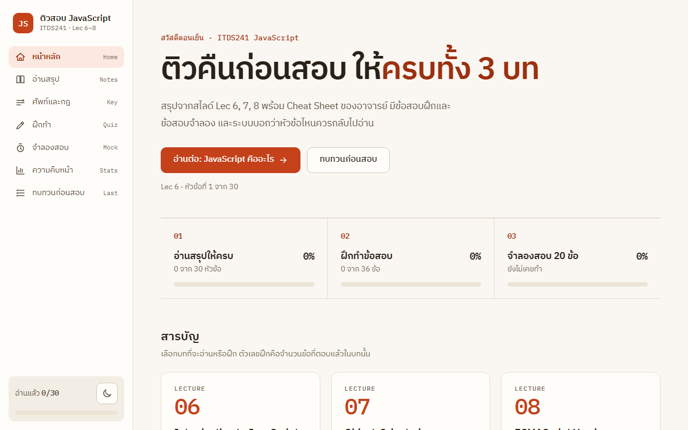
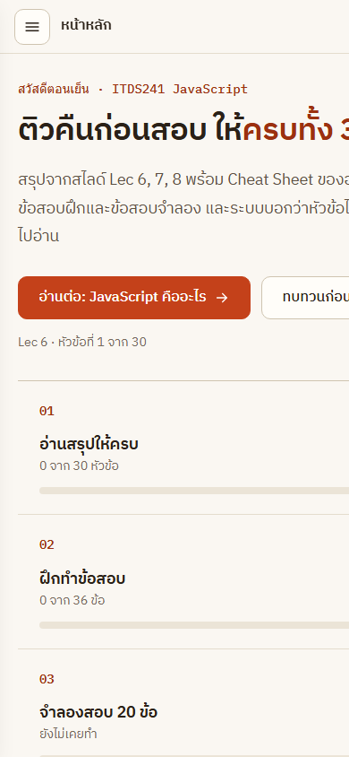

# ติวสอบ JavaScript (ITDS241)

เว็บติวสอบวิชา ITDS241 เรื่อง JavaScript บทที่ 6, 7, 8 พร้อม Cheat Sheet ของอาจารย์ ใช้อ่านสรุป ฝึกทำข้อสอบ และจำลองสอบในหน้าเดียว

**เปิดใช้งาน: https://thinnaphat-tht.github.io/Quiz-JavaScript/**

| เดสก์ท็อป | มือถือ |
| --- | --- |
|  |  |

## มีอะไรบ้าง

| ส่วน | เนื้อหา |
| --- | --- |
| อ่านสรุป | 30 หัวข้อ ครบ Lec 6–8 และ Cheat Sheet |
| ศัพท์และกฎ | รวมคำศัพท์และกฎที่ต้องจำ |
| ฝึกทำ | 36 ข้อ แยกตามหัวข้อ |
| จำลองสอบ | 20 ข้อ จับเวลา |
| ความคืบหน้า | บอกว่าหัวข้อไหนควรกลับไปอ่านซ้ำ |
| ทบทวนก่อนสอบ | รวมสิ่งที่ควรดูอีกรอบ |

เนื้อหาในแต่ละบท:

- **Lec 6** Introduction to JavaScript: ตัวแปร ชนิดข้อมูล Operators โครงสร้างควบคุม และโปรเจกต์ Tic Tac Toe
- **Lec 7** Object-Oriented Programming: Function, Constructor, Callback, Scope, Closure, Class, Inheritance
- **Lec 8** DOM, Events และ ECMAScript ตั้งแต่ ES6 ถึง ES2026 รวม Promises และ Async/Await
- **Cheat Sheet** String, Array, Value vs Reference, Math, Date, Window object, DOM Events

## หลักการ

- เนื้อหาอิงจากสไลด์ของอาจารย์เท่านั้น ส่วนที่ผู้เขียนเพิ่มเองจะมีป้าย "หมายเหตุ"
- ทุกข้อที่ถามผลลัพธ์ของโค้ด ผ่านการรันจริงแล้ว เฉลยไม่ได้เดา (ตรวจด้วย `src/verify.js`)
- มีโหมดมืด/สว่าง และใช้บนมือถือได้
- ความคืบหน้าเก็บในเบราว์เซอร์ของคุณเอง (`localStorage`) ไม่ส่งไปที่ไหน

## แก้ไขและ build

ไม่ต้องติดตั้งอะไร ต้องมี [Node.js](https://nodejs.org) อย่างเดียว

```bash
node src/verify.js   # ตรวจคลังข้อสอบ เฉลย และการคิดคะแนน
node src/build.js    # รวม CSS และ JS เป็น index.html ไฟล์เดียว
```

แก้เนื้อหาที่ `src/` แล้วรัน `build.js` ใหม่ทุกครั้ง ไฟล์ `index.html` กับ `JS-Exam-Guide.html` ถูกสร้างจากคำสั่งนี้ อย่าแก้ตรง ๆ

| ไฟล์ | หน้าที่ |
| --- | --- |
| `src/notes-*.js` | เนื้อหาสรุปแต่ละบท |
| `src/quiz-practice.js` | ข้อสอบฝึก |
| `src/quiz-mock.js` | ข้อสอบจำลอง |
| `src/app.js`, `src/logic.js` | ตัวเว็บและการคิดคะแนน |
| `src/styles.css`, `src/template.html` | หน้าตา |

ไฟล์ PDF สไลด์ของอาจารย์ไม่ถูกอัปโหลดขึ้น repo
